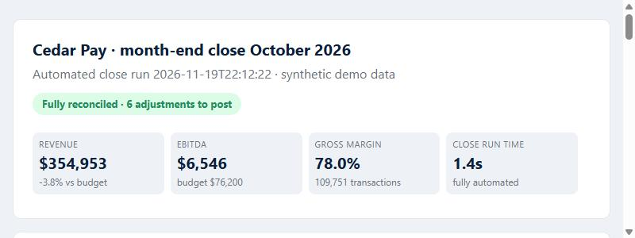
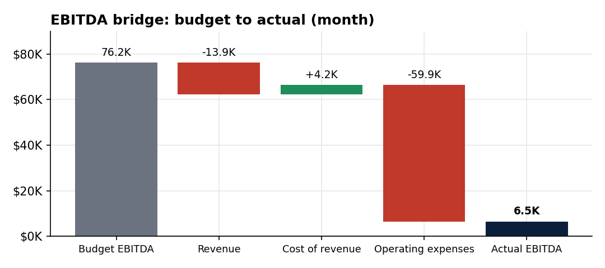

# Month-End Close Automation

A Python pipeline that runs a fintech's **month-end close in under 2 seconds**. It reads 7 messy source-system extracts, runs data-quality checks, loads a SQL warehouse, reconciles bank, revenue and payroll **with automatic root-cause hints**, explains budget variances in plain English, and writes an **Excel management pack** and an **HTML summary email**. It is tested and runs on a monthly GitHub Actions schedule.

> At my current fintech role I automated end-to-end financial reporting across 10+ sources, cutting month-end close reporting time by 80%. That work is confidential, so this project rebuilds the approach for **Cedar Pay**, a fictional money-transfer and bill-payment company, using synthetic data.



**See the output without running anything:** [`sample_output/`](sample_output/) holds the October 2026 [Excel pack](sample_output/Cedar_Pay_Close_Pack_2026-10.xlsx), the [HTML summary](sample_output/close_summary_2026-10.html) (download it to view) and the [run log](sample_output/run_log.json).

## What it does

```
 7 source extracts ──► ingest & standardise ──► data-quality rules ──► SQLite warehouse
                                                                          │
     Excel pack ◄── reports ◄── variance + commentary ◄── P&L mart (SQL) ◄┤
     HTML email                                                           │
                              reconciliations: bank USD · bank EUR · revenue · payroll
```

| Source system | Format and quirks the pipeline handles |
|---|---|
| ERP general ledger | CSV, dd/mm/yyyy dates (one module exports ISO), "1,234.50" amounts |
| Transaction platform | Gzipped JSON lines, ~110K transactions a month in USD/LBP/EUR |
| Bank A (USD) | Excel with a free-text header block, mm/dd/yyyy dates, running balance |
| Bank B (EUR) | European CSV: `;` separators, `1.234,56` numbers, YYYYMMDD dates, closing-balance trailer |
| Payroll register | Excel, departments mapped to cost centers |
| Budget | Wide Excel (months as columns), reshaped to long format |
| FX rates | Monthly average rates (EUR, LBP) |

## October 2026 close: what it found

The generator plants the problems a real close runs into. Every one is detected and explained, while January to September close with **zero open items** (this is covered by tests).

**Data quality (6 warnings, nothing silently dropped)**
| Check | Action |
|---|---|
| Duplicate journal entry (same lines re-posted under a new JE number) | Later duplicate excluded |
| Posting dated 2 Nov in the October export | Excluded from the period (cut-off) |
| ISO date in a dd/mm/yyyy column | Parsed with fallback, flagged |
| Missing cost center (2 lines) | Mapped to `UNALLOCATED` |
| 3 duplicate transaction IDs | Removed |
| 2 transactions with no fee | Fee rebuilt from the tariff card |

**Reconciliations (all fully explained, $0 unexplained)**
| Reconciliation | Item | Root cause identified automatically |
|---|---|---|
| Bank A (USD) | Deposit in transit $11,142 | 31 Oct settlement credited by the bank in November |
| Bank A (USD) | Outstanding payment $78,166 | Agent commissions paid 31 Oct, not yet cleared |
| Bank A (USD) | Unrecorded bank charges $1,048 | On the statement, not booked; matched by narrative |
| Bank A (USD) | Payroll amount difference $4,617 | Same amount as the payroll reconciliation item below |
| Bank B (EUR) | €180 amount difference | Keying error: €7,425.00 booked as €7,245.00 |
| Revenue | Bill payments −$857 | **Equals the fees from 31 Oct**: last day not posted (cut-off error) |
| Revenue | FX margin +$981 | **Equals the fees on reversed deals**: reversals booked as revenue |
| Payroll | TECH −$4,617 | **Equals the total cost of EMP-0051**: a new joiner missing from the GL journal |

Bank matching runs in two passes: by reference first, then by **amount and date (±3 days)** for lines with no usable reference, such as bank charges.

**Budget variance commentary (generated automatically)**
> *Marketing was $37,040 above budget (+148%), adverse. Largest cost-centre impact: MKT. Main postings: Q4 brand campaign - outdoor ($38,000); Digital advertising ($24,040).*
>
> *Professional fees was $23,465 above budget (+313%), adverse. Largest cost-centre impact: FIN. Main postings: Statutory audit - interim fieldwork ($22,000); Legal & advisory retainer ($8,965).*

A variance is flagged only when **both** materiality thresholds are breached (≥ $5K and ≥ 10%), the way a controller would screen them. Those two one-offs explain most of the EBITDA miss: **$6.5K actual against $76.2K budget**.



## Outputs
- **Excel management pack** (9 sheets): Summary · P&L vs budget (month and YTD) · By account with Adverse/Favourable flags · By cost center · Commentary · Reconciliation summary · Reconciling items · Data-quality log · Cleaned GL detail (ready for Power BI)
- **HTML close summary:** a self-contained, email-ready page with KPI tiles, the P&L, an EBITDA bridge, the commentary, reconciliation status, the adjustments to post and data quality
- **`run_log.json`** plus a `run_log` table in the warehouse, with per-step timings and row counts
- **Exit code** `1` if anything blocks the close (a data-quality *error* or an *unexplained* reconciliation difference), so a scheduler can alert someone

## SQL warehouse
`data/warehouse.db` (SQLite) holds `fact_gl`, `fact_budget`, `fact_platform_daily`, `dim_account`, `recon_items`, `dq_issues` and `run_log`. Loads are **idempotent**: re-running a period replaces it rather than duplicating it (this is tested). The P&L mart is a single SQL query with CTEs ([`src/warehouse.py`](src/warehouse.py)).

## Run it

```bash
python -m venv .venv
.venv\Scripts\activate          # macOS/Linux: source .venv/bin/activate
pip install -r requirements.txt

python generate_data.py          # synthetic source extracts, Jan-Oct 2026
python close.py --period 2026-10 # writes output/2026-10/
pytest -q                        # 15 tests
```

**Scheduling:** [`.github/workflows/month-end-close.yml`](.github/workflows/month-end-close.yml) runs on the 3rd of every month (and on demand). It generates the data, runs the tests, performs the close and uploads the pack as a build artifact. On a company server the same command runs from cron or Windows Task Scheduler.

## Project structure

```
month-end-automation/
├── close.py              # orchestrator: steps, timings, exit code
├── generate_data.py      # synthetic, deliberately messy source systems
├── config.yaml           # chart of accounts, materiality, tolerances, tariff
├── src/
│   ├── ingest.py         # one reader per source system
│   ├── quality.py        # data-quality rules -> issues log
│   ├── warehouse.py      # SQLite schema, idempotent loads, P&L SQL
│   ├── reconcile.py      # bank / revenue / payroll recs + root-cause hints
│   ├── variance.py       # budget vs actual, materiality, commentary, KPIs
│   ├── report_excel.py   # formatted 9-sheet workbook
│   └── report_html.py    # email-ready summary with embedded charts
├── tests/test_close.py
└── sample_output/        # October 2026 pack, summary and run log
```

---
**Joey El Gemayel**, Financial Data Scientist · [Portfolio](https://joeygem.github.io) · [LinkedIn](https://linkedin.com/in/joey-el-gemayel-682924b0)
